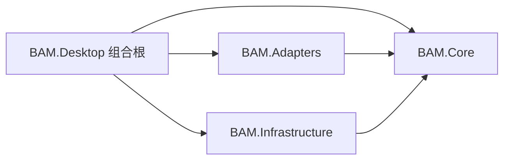

# BAM 架构与运行边界

**设计目标**　桌面应用内组合少量可测试模块。三个程序的共同路径从发现、身份确认、采样直到界面显示只实现一次；适配器仅负责第三方特有的启动契约、信号解释和功能开关。

**实现状态**　Phase 3 在 Phase 2.1 桌面基线上接入真实安装与通用 Windows 管理。Adapters 和 Infrastructure 已纳入解决方案。后续的游戏适配和回环协议仍保留设计边界。[Phase 3 报告](PHASE3_REPORT.md)

## 解决方案与依赖

```text
BAM.slnx                         Phase 1 建立
global.json / .editorconfig / Directory.Build.props / Directory.Packages.props
src/BAM.Desktop                  WPF 壳、导航、主题、ViewModel、托盘、组合根
src/BAM.Core                     定义、观测快照、命令协调、状态迁移、端口
src/BAM.Infrastructure           Known Folder、lnk、Win32、图标、安装存储和 BAM 日志
src/BAM.Adapters                 安装解析、版本来源、进程采样与操作协调
tests/BAM.Tests                  可独立于 Windows UI 的逻辑测试
tests/BAM.Desktop.Tests          桌面回归、分开启用的 Windows 夹具与真实只读观测
docs/                            设计与证据
poc/                             独立调查夹具，不参与产品构建
```

项目、资源和 CI 文件随首个实现用例建立。Desktop 项目的 AssemblyName=BAM、RootNamespace=BAM；类按 BAM.Desktop、BAM.Core 等归类。BAM.Core 不依赖 WPF、Win32 或具体适配器。



**数据流**　Desktop 通过 DI 注册真实 `IDesktopData`。后台 `ProgramMonitor` 通过 Core 端口读取 Windows 安装、进程和窗口，按安装 ID 生成观测快照及事件。Desktop 在 Dispatcher 发布快照，命令携带安装记录、进程身份与窗口句柄交由协调器复核。BBchannel 用通用流程加固定的已验证工作程序位置。

## 运行对象与能力契约

| 数据 | 关键字段与用途 |
|---|---|
| ProgramInstallation / ScriptDefinition | 安装包含稳定 ID、类型、原始入口、解析后的启动目标、工作目录、参数、图标来源和工作程序路径。执行控制时通过 ScriptDefinition 沿用 Phase 1 的路径归属检查。 |
| ProcessIdentity | 实际规范化映像路径、PID、UTC 创建时间；必要时辅以文件身份、会话、命令行及父子关系。快照与命令均携带这一身份。 |
| Observation | 安装 ID、进程身份或协议设备、会话 ID、时间、来源、作用范围、观测值及新鲜度。日志偏移用于去重，不对外泄露原记录。 |
| Capability | 例如 ReadResources、ActivateWindow、CloseProcess、ForceTerminate、StartTaskFromProfile、RequestStopTask、ReadTaskOutcome。安装级能力与当前可用性分开，附来源、适用版本和不可用原因。 |
| CommandResult | Accepted / Completed / Unsupported / Denied / TimedOut / IdentityChanged / Failed；带操作 ID 和诊断原因。回报 Accepted 后继续观察，不立即显示任务完成。 |

Phase 3 端口为 `IProgramFiles`、`IProgramPlatform`、`IProgramStore` 和 `IProgramEventStore`。通用能力来自实际进程、窗口、安装及权限观测。独立的游戏任务与远程指令状态契约已存在，MaaEnd 实例选择和 MAA 远控将在后续授权验证时接入。

## 四种相互独立的状态

| 轴 | 状态 | 证据及迁移 |
|---|---|---|
| 安装和进程 | 未定位、路径失效、已停止、启动中、运行中、关闭中、疑似异常退出、未知 | 首次未发现路径可手动定位；只有确认映像和创建时间才进入运行中。持有退出意图且实例退出，转已停止；无意图的消失先记录退出原因未知，结合已知异常码/崩溃记录再标疑似异常。 |
| 窗口 | 未观测、无可见窗口、可见、最小化；响应另为正常、疑似无响应、未知 | 以所属顶层 HWND 为准。可见性与响应分别更新。无窗口的后台程序仍可运行，窗口消失不等于进程退出。 |
| 游戏任务 | 不支持、未知、空闲、启动中、执行中、停止中、已完成、已取消、失败 | 只有适配器提供同一会话、同一作用域的信号才迁移。重启后清除当前任务证据。已取消独立显示。暂停、恢复、疑似卡死仅在某适配器有可重复依据时扩展。 |
| 远程指令 | 排队、已提供给客户端、接收/执行已证实、已回报、超时未知 | 以配对身份和唯一命令 ID 跟踪。客户端取任务响应发出后仍有传输不确定性。只在有心跳或回报时推进可证明的状态。 |

终态带来源与时间。重复终态幂等；过期证据不覆盖新会话，矛盾证据保留诊断并降级未知。手工启动的任务允许没有 BAM 命令。计数仅包含任务状态可证明且最新者，展示可检测覆盖数。进程退出时保存上一个已知任务观测，未闭合运行标为“结果未知”。

## 进程、窗口与资源

1. 按桌面 Known Folders、OneDrive 候选桌面和有限深度的开始菜单发现链接。解析出的入口、目标和工作路径分别保存。相同工作路径去重，不同路径各自保留安装 ID。自动发现尊重用户修改和已移除记录。
2. 每轮用一个 Tool Help 快照。可执行文件名缩小候选范围，实际 Win32 映像路径、PID 与创建时间确认身份。快捷方式与版本约每 30 秒复核。无法读取同名候选或发现多实例时降为未知。
3. 按安装 ID 互斥。启动前重新读取入口并枚举工作进程。EXE 启动保留工作目录和 Windows 参数，CMD/BAT 使用系统命令解释器及受限参数语法。BBchannel 执行原批处理。快捷方式的提权标记保留到该次目标启动。
4. `WM_CLOSE` 仅向复核后的 HWND 提交，最多等待八秒确认原身份的进程句柄已发出退出信号。采样先读到的退出证据会保留给进行中的命令。重启还需重新确认当前无其他匹配实例。强制结束仅针对复核后的目标句柄。
5. `EnumWindows` 按已确认 PID 筛窗口，读取标题、最小化和响应状态。激活或恢复来自用户点击，仍受 Windows 前台规则和完整性级别限制。
6. 保留已确认工作进程的查询句柄，从信号状态与退出码确认退出。采样约为前台一秒、最小化五秒、托盘十秒，所有卡片共享同一次采样。启动后等待实际工作进程，启动器退出不会直接推进工作进程状态。
7. CPU 使用单调时间差和逻辑处理器数归一化，长间隔、缺样本或进程身份变化会断线。工作集使用 MiB，运行时长从实际创建时间计算。汇总按身份去重，观测覆盖不足留空并显示覆盖数。

## 日志、配置和回环服务

- **BAM 运行日志**　从已确认的状态变化和操作反馈生成结构化事件。UI 与启动回放最多 2,000 条，文件最多四份，每份约 1 MiB，启动时清理超过 14 天的日志。记录含时间、来源、安装 ID、级别和诊断消息。路径、启动参数和第三方窗口标题留在实时详情。
- **配置**　`%LocalAppData%\BAM` 下的 `settings.json` 保存偏好，`installations.json` 保存安装及发现排除路径。各自有 schema 版本、串行原子替换及备份。安装存储遇到损坏会尝试备份并保留诊断原件，遇到更高版本时阻止覆盖。
- **写入权限**　通过当前进程令牌的 TokenElevation 判定权限。提升或无法判定时只读普通用户目录，设置、安装修改与新增日志只保留在内存，也跳过旧日志清理。普通会话遇到安装文件共享冲突或访问拒绝时停用安装写入，重开后重新判断。启动与重启确认展示实际入口目标、工作目录和参数。
- **后续日志追读与 MAA HTTP**　第三方任务日志按版本与作用域校准，需覆盖文件偏移、轮转、截断和编码。MAA 远控待用户启用后显式绑定 IPv4 回环，按配对、命令 ID 和回报关联状态。

## 生命周期与验证

### Phase 1 已落地的边界

Desktop 在 WPF UI 线程上获取具名 Mutex。对象名包含运行时取得的用户 SID，CurrentUserOnly 限定访问，锁跨该用户的会话，保证只存在一个应用写入者。互斥所有者异常退出时由下一实例取得遗弃锁。只有主实例构建 DI 和窗口。激活使用当前用户、当前会话的自动重置 EventWaitHandle，仅传一个唤起信号，没有参数或控制指令。并发冷启动时，次实例在短暂有界等待内打开信号；收到信号后主实例调度到 Dispatcher，必要时还原窗口并调用 Activate。系统可限制前台焦点。

次实例发信成功退出码为 0，未找到同会话接收端为 2（例如主实例在其他会话），对象拒绝访问为 3。当前已验证同用户、同会话、普通权限。资源管理器退出、跨会话和异常退出竞争留至 Windows 集成回归。Phase 2 已在主实例启用桌面偏好写入。

### Phase 3 运行与退出

正式版的 `IDesktopData` 使用 Windows 安装和进程数据。单独演示构建显式传入 `--demo` 后使用合成数据及会话内偏好。托盘和最小化继续复用同一单实例激活路径。

第三方操作从普通权限发起。Windows 可为用户确认的单次启动请求提权。UAC 取消显示拒绝，跨完整性窗口控制按权限条件降级。休眠后的长采样间隔使 CPU 留空。退出仅清理 BAM 持有的资源。

Core 目前以会话 ID 与开场时间隔离观察流，远程回报另校验命令 ID。对于同一状态轴，较旧证据被忽略，同一时刻的矛盾证据降级为未知，直到收到更新的观察。保留最新来源与时间。本切片处理归一化信号；真实适配器仍须生成可靠时间、区分证据作用域，并在执行前重新验证持有句柄。

App 加载本地设置后在后台运行发现与观测。进入托盘降低采样频率并停止图表绘制，恢复时唤醒采样。正常关闭先取消后台监控和操作，再异步等待保存及收尾，等待上限为三秒。操作和保存退出后释放句柄、订阅、托盘和取消源。被管理的软件继续运行。

单元测试注入假时钟和快照，重放 PID 复用、重复命令、过期事件、权限拒绝和适配器故障。日志测试用合成或脱敏片段覆盖轮转、跨块字符、取消、失败后重试。协议测试涵盖重复、丢失、乱序、端口冲突和服务关闭。Windows 测试仅操作专用夹具。真实应用用单独分类、明确授权和版本清单。新增程序优先复用 Generic；只有新增语义且有证据时才扩充 capability、适配器、样本和 UI 文案。
