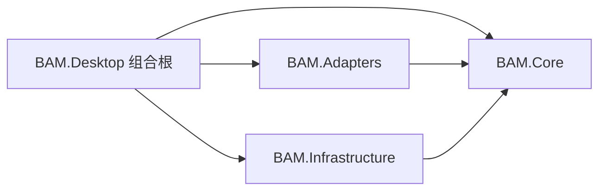

# BAM 架构与运行边界

**设计目标**　桌面应用内组合少量可测试模块。三个程序的共同路径从发现、身份确认、采样直到界面显示只实现一次；适配器仅负责第三方特有的启动契约、信号解释和功能开关。

**实现状态**　Phase 1 已交付 Desktop 验证窗口与组合根、Core 契约和 Tests。下图与目录包含后续设计。Adapters 和 Infrastructure 在首个具体实现时建立，桌面壳在 Phase 2 开发。

## 解决方案与依赖

```text
BAM.slnx                         Phase 1 建立
global.json / .editorconfig / Directory.Build.props / Directory.Packages.props
src/BAM.Desktop                  WPF 壳、导航、主题、ViewModel、托盘、组合根
src/BAM.Core                     定义、观测快照、命令协调、状态迁移、端口
src/BAM.Infrastructure           Known Folder、lnk、Win32、采样、文件、回环传输
src/BAM.Adapters                 Generic、MaaEnd、Maa，解释版本化接口及事件
tests/BAM.Tests                  单元、夹具、分类执行的 Windows 集成测试
docs/                            设计与证据
poc/                             独立调查夹具，不参与产品构建
```

项目、资源和 CI 文件随首个实现用例建立。Desktop 项目的 AssemblyName=BAM、RootNamespace=BAM；类按 BAM.Desktop、BAM.Core 等归类。BAM.Core 不依赖 WPF、Win32 或具体适配器。



**数据流。** 用户命令 → ViewModel → Core 协调器 → 选定适配器或通用进程服务 → 基础设施。反向路径为原生观测/协议回报 → 适配器归一化、注明证据 → Core 按安装与实例归并 → 不可变快照 → UI 线程批量更新。UI 不轮询进程、不解析日志。Infrastructure 不需要知道 LinkStart 的游戏语义。DI 在 App 启动时连接端口。首版用显式注册，BBchannel 用通用适配器加声明式启动器描述。

## 运行对象与能力契约

| 数据 | 关键字段与用途 |
|---|---|
| ScriptDefinition | BAM 生成的稳定 ID、显示名、游戏、适配器类型、用户确认的入口/参数/工作目录、允许的工作程序路径。快捷方式目标、图标和检测到的版本可刷新。 |
| ProcessIdentity | 实际规范化映像路径、PID、UTC 创建时间；必要时辅以文件身份、会话、命令行及父子关系。快照与命令均携带这一身份。 |
| Observation | 安装 ID、进程身份或协议设备、会话 ID、时间、来源、作用范围、观测值及新鲜度。日志偏移用于去重，不对外泄露原记录。 |
| Capability | 例如 ReadResources、ActivateWindow、CloseProcess、ForceTerminate、StartTaskFromProfile、RequestStopTask、ReadTaskOutcome。安装级能力与当前可用性分开，附来源、适用版本和不可用原因。 |
| CommandResult | Accepted / Completed / Unsupported / Denied / TimedOut / IdentityChanged / Failed；带操作 ID 和诊断原因。回报 Accepted 后继续观察，不立即显示任务完成。 |

适配器最小契约（设计签名，按切片逐步实现）：

```csharp
CapabilitySet Probe(InstallationFacts installation);
Task<CommandResult> ExecuteAsync(ScriptCommand command, CancellationToken cancellation);
IAsyncEnumerable<Observation> ObserveAsync(ScriptContext context, CancellationToken cancellation);
```

Probe 根据已采集事实生成能力，不执行第三方程序。通用管理由 Core 复用 IProcessService、IWindowService、IResourceSampler 等实际需要的端口。MaaEnd 使用实例名和日志事件；Maa 使用远控队列及日志；两者均委托通用管理。不支持的请求直接返回 Unsupported，条件不具备时说明原因。单个适配器订阅异常在该脚本边界结束、记录并有限退避重试，其他适配器继续运行。

## 四种相互独立的状态

| 轴 | 状态 | 证据及迁移 |
|---|---|---|
| 安装和进程 | 未定位、路径失效、已停止、启动中、运行中、关闭中、疑似异常退出、未知 | 首次未发现路径可手动定位；只有确认映像和创建时间才进入运行中。持有退出意图且实例退出，转已停止；无意图的消失先记录退出原因未知，结合已知异常码/崩溃记录再标疑似异常。 |
| 窗口 | 未观测、无可见窗口、可见、最小化；响应另为正常、疑似无响应、未知 | 以所属顶层 HWND 为准。可见性与响应分别更新。无窗口的后台程序仍可运行，窗口消失不等于进程退出。 |
| 游戏任务 | 不支持、未知、空闲、启动中、执行中、停止中、已完成、已取消、失败 | 只有适配器提供同一会话、同一作用域的信号才迁移。重启后清除当前任务证据。已取消独立显示。暂停、恢复、疑似卡死仅在某适配器有可重复依据时扩展。 |
| 远程指令 | 排队、已提供给客户端、接收/执行已证实、已回报、超时未知 | 以配对身份和唯一命令 ID 跟踪。客户端取任务响应发出后仍有传输不确定性。只在有心跳或回报时推进可证明的状态。 |

终态带来源与时间。重复终态幂等；过期证据不覆盖新会话，矛盾证据保留诊断并降级未知。手工启动的任务允许没有 BAM 命令。计数仅包含任务状态可证明且最新者，展示可检测覆盖数。进程退出时保存上一个已知任务观测，未闭合运行标为“结果未知”。

## 进程、窗口与资源

1. 启动时检查标准桌面位置，解析 lnk 的目标、参数、图标、工作目录，校验实际文件，按规范化路径去重。同名不同安装列出让用户选。路径消失重新探测并保留旧绑定供确认。
2. 每轮只取一次候选列表，再以有限查询权限取映像与创建时间。缓存静态元数据；版本/文件时间或身份变化时作废。父子启动链仅用于发现候选。BBchannel 观察限定目录下的工作 EXE；通用自定义启动器须配置工作程序。遇到无权限或歧义则不下发控制命令。
3. 按安装 ID 串行化启动/关闭/重启。启动前再次枚举；运行或身份未定时不重复开进程。保留原快捷方式、参数和目录；不把用户字符串拼成 cmd 命令。仅显式信任的现有批处理可由原快捷方式启动。手动选择的 EXE 参数按独立参数传递。若原配置会拉起模拟器或自动执行，操作前说明具体影响。
4. 请求正常关闭前重验窗口及身份，发送有界 WM_CLOSE 或 CloseMainWindow，等待退出；转托盘或超时明确显示“仍在运行”。重启只在旧身份确认消失后执行。强制结束单列危险操作，确认实例后仅结束持有句柄的该进程。绝不自动升级为 Kill 或终止进程树。
5. EnumWindows 按窗口 PID 过滤，采样响应设超时。用户点击才 SW_RESTORE、SetForegroundWindow 并核对结果；失败提示交互切换，托盘程序可引导其原生方式打开。无障碍/跨完整性失败保留错误码。BAM 默认普通用户。
6. 进程退出优先监听句柄/Exited；服务开始先枚举已有实例，并周期校准解决丢事件、短命启动器和 PID 复用。不能拿到退出码就保留未知。监控启动只有一份，不为每张卡起定时器。
7. CPU 使用两次累计处理器时间差除以 Stopwatch 时间差与可用逻辑处理器数；首次、身份变化、系统睡眠或时钟间隔不合理时留空。默认只计确认的 GUI 主进程，多个确认实例按身份去重；后续允许白名单 helper 明确标注。内存卡片为 Working Set MiB，详情可查 Private Bytes；多进程工作集相加可能重复计算共享页。运行时长按实例创建时间计算。

## 日志、配置和回环服务

- **日志追读。** 启动时记录当前文件身份和末尾偏移；历史在独立视图重放，不能直接影响“现在”。FileSystemWatcher 只唤醒读取，短暂合并重复通知，以共享读/写/删除打开文件，按偏移批读，保留半行和未完成 UTF-8 字节。重命名时尽量读完旧句柄再打开新文件，截短重置位置。缓冲溢出或文件暂时占用时按文件身份/大小周期核对，有限退避。丢失区间标注缺口。以版本、会话、任务 ID 和事件来源去重，必要时保留原 scope；归档 gzip 按需流式读。[FileSystemWatcher 缓冲限制](https://learn.microsoft.com/en-us/dotnet/api/system.io.filesystemwatcher.internalbuffersize?view=net-10.0)
- **容量。** UI 最近 2000 条，每批最多 100 条、至多每 200 ms 派发一次，超限保留新记录并显示丢弃计数。日志列表虚拟化；搜索大文件可取消，导出按用户选择脱敏。BAM 自身日志按天/大小轮转，建议总量上限 50 MiB。调试输出不能无限缓存。
- **配置。** `%LocalAppData%/BAM/settings.json` 保存 schemaVersion、软件定义、主题和采样偏好。启动验证必填字段，分版本迁移，未来版本只读提示；写入同目录临时文件后原子替换，保留上次有效备份，首次写入用原子重命名。单写者按 revision 串行化；损坏文件保留诊断，恢复备份并告知用户。私有令牌使用当前用户保护存储，配置留引用。第三方配置仅按所需字段只读解析。
- **MAA HTTP。** 仅在启用后显式绑定 IPAddress.Loopback 和用户已确认的固定端口。配置变更不能隐式打开外部监听。端口占用则禁用此能力、显示冲突，重新选端口需同步原 GUI。仅两个 POST JSON 路由；限制 Host、请求体大小、速率和超时，拒绝未知 user/device、任务 ID、非法状态，默认不接收截图。随机私有路径及配对信息不写日志，不启用跨域访问。回环不能识别调用者身份。重复轮询使用同一 id，重复一致回报幂等，冲突回报记录；BAM 重启不自动重发非幂等游戏动作。桌面客户端自行配置端点。

## 生命周期与验证

### Phase 1 已落地的边界

Desktop 在 WPF UI 线程上获取具名 Mutex。对象名包含运行时取得的用户 SID，CurrentUserOnly 限定访问，锁跨该用户的会话，保证只存在一个应用写入者。互斥所有者异常退出时由下一实例取得遗弃锁。只有主实例构建 DI 和窗口。激活使用当前用户、当前会话的自动重置 EventWaitHandle，仅传一个唤起信号，没有参数或控制指令。并发冷启动时，次实例在短暂有界等待内打开信号；收到信号后主实例调度到 Dispatcher，必要时还原窗口并调用 Activate。系统可限制前台焦点。

次实例发信成功退出码为 0，未找到同会话接收端为 2（例如主实例在其他会话），对象拒绝访问为 3。保持只读或退出。当前只实测同用户、同会话、普通权限。资源管理器退出、跨会话、异常退出竞争等留至 Windows 集成回归。配置写入服务未来仅注册于主实例，仍按原有的原子替换、版本迁移和损坏恢复方案实施。

第三方操作默认从普通权限发起。后续在用户确认后才为已绑定的单个目标申请所需权限。UAC 取消返回取消/拒绝；无法读取身份、无法验证提权后的实际映像或参数时中止控制并重新观察；跨完整性消息失败保留权限错误。不得据此推断进程停止、自动重启或把操作标成成功。休眠恢复时取消过期采样、重置 CPU 基线并重新校准实例。退出只清理 BAM 持有的资源。

Core 目前以会话 ID 与开场时间隔离观察流，远程回报另校验命令 ID。对于同一状态轴，较旧证据被忽略，同一时刻的矛盾证据降级为未知，直到收到更新的观察。保留最新来源与时间。本切片处理归一化信号；真实适配器仍须生成可靠时间、区分证据作用域，并在执行前重新验证持有句柄。

App 建立一个组合根，加载本地设置、启动发现与观察，后台通过 CancellationToken 和有界队列运行。进入托盘降低采样并暂停绘制；恢复前台先取新样本，跨休眠区间断线。退出 BAM 时禁止接收新命令，停 HTTP 与 watcher，取消并有界等待 worker，刷写配置与日志，释放 Process、图标、HWND 订阅、计时器和 CTS；被管理的软件继续原有运行。

单元测试注入假时钟和快照，重放 PID 复用、重复命令、过期事件、权限拒绝和适配器故障。日志测试用合成或脱敏片段覆盖轮转、跨块字符、取消、失败后重试。协议测试涵盖重复、丢失、乱序、端口冲突和服务关闭。Windows 测试仅操作专用夹具。真实应用用单独分类、明确授权和版本清单。新增程序优先复用 Generic；只有新增语义且有证据时才扩充 capability、适配器、样本和 UI 文案。
